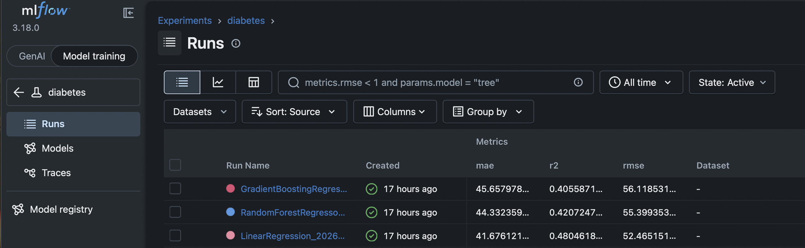
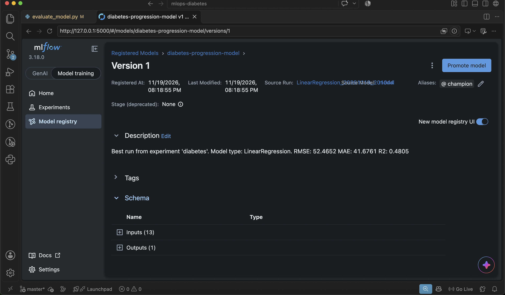
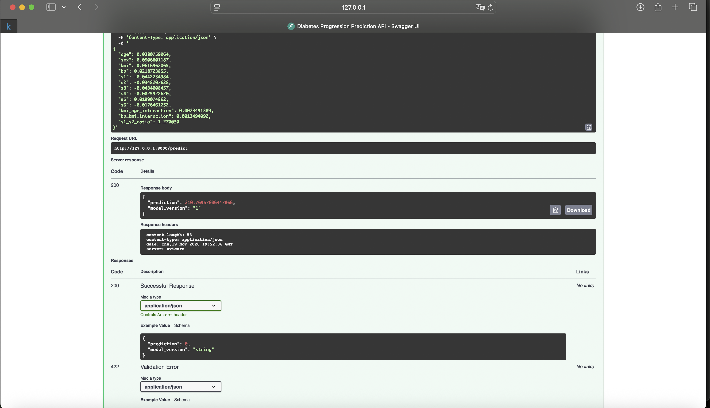
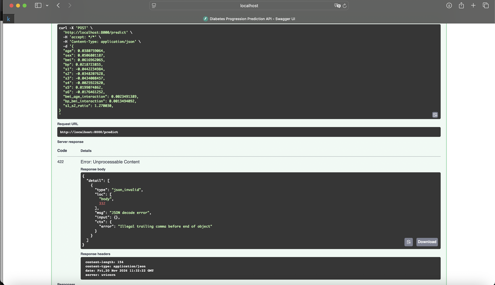
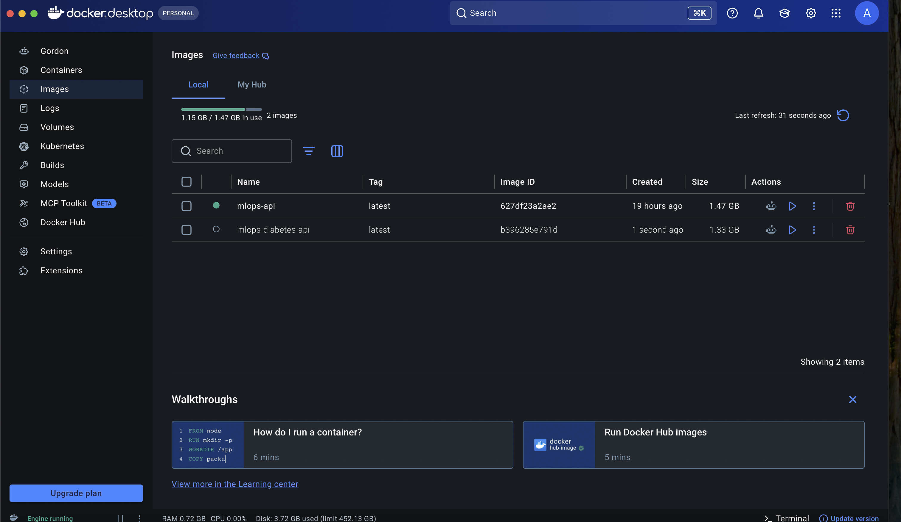
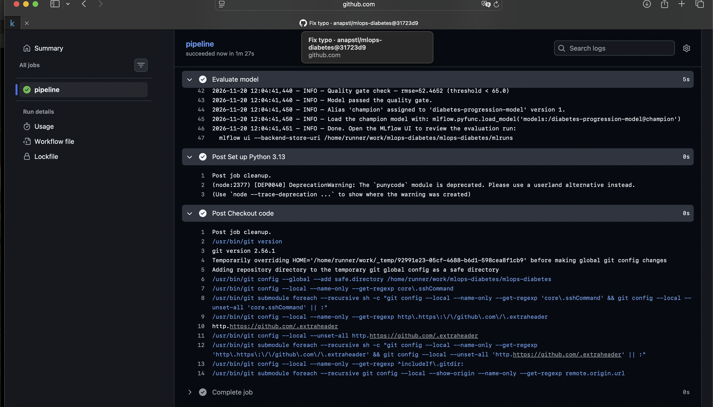

# Diabetes Progression Prediction: End-to-End MLOps

This project implements an end-to-end MLOps workflow for a regression task using the **Diabetes dataset from scikit-learn**. It starts with EDA in a Jupyter notebook and develops that work into reusable data-processing scripts, tracked machine learning experiments, a versioned model registry, a prediction API, a Docker image, and an automated GitHub Actions pipeline.

The goal is to demonstrate the main stages of an MLOps lifecycle in a reproducible educational project, rather than to deploy a clinically validated prediction system.

## 1. Dataset and problem definition

The task is to predict a **quantitative measure of diabetes disease progression one year after baseline**, using patient-related numerical measurements.

The dataset contains **442 observations**, **10 original input features** (`age`, `sex`, `bmi`, `bp`, and `s1` through `s6`), and one continuous target column, `target`. The input variables provided by scikit-learn are standardized. This is a **regression** problem, so the API returns a numerical progression score, not a diagnosis, probability, or percentage.

The exploratory notebook, `Proyecto_MLOps.ipynb`, covers dataset inspection, validation, cleaning, train/test splitting, comparison of regression algorithms, and experimentation with additional features. The scripts in `src/` translate these steps into an executable MLOps workflow.

## 2. Technology stack

- Python 3.13
- scikit-learn, pandas, and NumPy for data processing and modeling
- Pydantic for data and API input validation
- MLflow 3.18.0 for experiment tracking, evaluation, and the Model Registry
- FastAPI and Uvicorn for model serving
- Docker for containerized serving
- GitHub Actions for continuous integration (CI)

## 3. Repository structure

```text
mlops-diabetes/
├── .github/
│   └── workflows/
│       └── ci.yml
├── data/
│   ├── raw/
│   │   └── diabetes_dataset.csv
│   └── processed/
│       ├── train_v1.csv
│       └── train_features_v1.csv
├── docs/
│   ├── img/
│   │   ├── api-health-200.png
│   │   ├── api-model-info-200.png
│   │   ├── api-predict-200.png
│   │   ├── api-predict-error-422.png
│   │   ├── docker-desktop-diabetes.png
│   │   ├── github-actions-ci-pipeline.png
│   │   ├── mlflow_champion.png
│   │   ├── mlflow-experiments.png
│   │   └── swagger-api.png
├── notebooks/
│   └── Proyecto_MLOps.ipynb
├── src/
│   ├── data/
│   │   ├── load_data.py
│   │   ├── validate_data.py
│   │   ├── preprocess.py
│   │   └── feature_engineering.py
│   ├── models/
│   │   ├── train.py
│   │   ├── register_model.py
│   │   └── evaluate_model.py
│   └── api/
│       ├── schemas.py
│       ├── model.py
│       └── main.py
├── Dockerfile
├── .dockerignore
├── .gitignore
├── requirements.txt
├── requirements-api.txt
└── README.md
```

## 4. Installation

Run these commands from the repository root:

```bash
python3.13 -m venv .venv
source .venv/bin/activate
pip install -r requirements.txt
```

On Windows, activate the environment with `.venv\Scripts\activate` instead.

MLflow's local filesystem backend must be enabled for the version used in this project:

```bash
export MLFLOW_ALLOW_FILE_STORE=true
```

On Windows PowerShell, use `$env:MLFLOW_ALLOW_FILE_STORE="true"`.

## 5. Data engineering pipeline

The data workflow follows the preparation steps demonstrated in the exploratory notebook:

```bash
python src/data/load_data.py
python src/data/validate_data.py
python src/data/preprocess.py
python src/data/feature_engineering.py
```

| Step | Purpose | Output |
|---|---|---|
| `load_data.py` | Load the scikit-learn Diabetes dataset | `data/raw/diabetes_dataset.csv` |
| `validate_data.py` | Validate required fields and numeric types using Pydantic | Validation results in the terminal |
| `preprocess.py` | Remove missing values and duplicates; ensure numeric types | `data/processed/train_v1.csv` |
| `feature_engineering.py` | Generate three additional input variables | `data/processed/train_features_v1.csv` |

The original dataset has **442 rows and 11 columns**, including the target. After feature engineering, the processed dataset has **442 rows and 14 columns**: 13 input features and one target.

The engineered variables are:

| Feature | Calculation |
|---|---|
| `bmi_age_interaction` | `bmi * age` |
| `bp_bmi_interaction` | `bp * bmi` |
| `s1_s2_ratio` | `s1 / (s2 + 1e-9)` |

The small constant in the ratio denominator avoids division by zero. The pipeline retains all 442 observations for this dataset.

**Rerunning the pipeline:** the current data-saving logic protects existing output files against accidental overwriting. If the generated CSV files already exist, remove the corresponding outputs before rerunning those steps from scratch.

## 6. Training and MLflow experiment tracking

Run the training script after preparing the data:

```bash
python src/models/train.py
```

The script trains and compares three regression algorithms:

- `LinearRegression`
- `RandomForestRegressor` with 100 estimators and `random_state=42`
- `GradientBoostingRegressor` with `random_state=42`

The experiments use the 13 engineered input features and an **80/20 train/test split** (`test_size=0.2`, `random_state=42`), corresponding to **353 training observations and 89 test observations**.

Each model is recorded in the MLflow experiment named `diabetes`, including its parameters, evaluation metrics, and model artifacts. The comparison uses **RMSE**, **MAE**, and **R²**, with lower RMSE preferred when selecting the best run.

### Recorded model evaluation

The best registered model in the completed local run was **LinearRegression**. Evaluation of the registered model produced:

| Metric | Result |
|---|---:|
| Root Mean Squared Error (RMSE) | **52.4652** |
| Mean Absolute Error (MAE) | **41.6761** |
| R² | **0.4805** |
| Evaluation observations | **89** |

RMSE penalizes larger prediction errors more strongly, MAE summarizes average absolute error, and R² describes the proportion of target variation explained by the model. These are results from this project's recorded evaluation, not guaranteed values for every future retraining run.

### MLflow interface

To inspect experiment runs and the Model Registry, start the MLflow UI from the project root:

```bash
mlflow ui --backend-store-uri ./mlruns
```

Open `http://localhost:5000`.

## 7. Model Registry and champion selection

Register the model associated with the lowest RMSE:

```bash
python src/models/register_model.py
```

The model is registered under the name **`diabetes-progression-model`**. The first successful registration in the completed run created **version 1**.

Evaluate the latest registered version and apply the quality gate:

```bash
python src/models/evaluate_model.py
```

The quality criterion is:

```text
RMSE < 65.0
```

The observed RMSE was **52.4652**, so the model passed the gate and MLflow assigned the **`champion`** alias to version 1.

The threshold of 65 was selected as a straightforward educational acceptance criterion for this regression exercise. It is above the observed evaluation RMSE while still requiring a finite level of predictive accuracy. It is **not a clinically established threshold**, and passing it does not imply that the model is suitable for medical decisions.

The API references the alias instead of hard-coding a model version:

```python
model_uri = "models:/diabetes-progression-model@champion"
```

A newly promoted champion can be served after restarting the API so that the model is loaded again. The current workflow uses the same held-out test partition for model comparison and registered-model evaluation; a separate final test set would provide a stronger independent assessment in a production project.

## 8. FastAPI model serving

Once the model has been registered and assigned the `champion` alias, start the API locally:

```bash
uvicorn src.api.main:app --reload
```

Interactive documentation is available at `http://localhost:8000/docs`.

| Method | Endpoint | Purpose |
|---|---|---|
| `GET` | `/health` | Check that the service is running |
| `GET` | `/model-info` | Inspect the loaded model's name, version, alias, and metadata |
| `POST` | `/predict` | Submit 13 numerical features and receive a prediction |

### Example prediction request

The API accepts the original ten features **and the three engineered features**. The following values are an illustrative request, not an actual patient record:

```bash
curl -X POST http://localhost:8000/predict \
  -H "Content-Type: application/json" \
  -d '{
  "age": 0.0380759064,
  "sex": 0.0506801187,
  "bmi": 0.0616962065,
  "bp": 0.0218723855,
  "s1": -0.0442234984,
  "s2": -0.0348207628,
  "s3": -0.0434008457,
  "s4": -0.0025922620,
  "s5": 0.0199074862,
  "s6": -0.0176461252,
  "bmi_age_interaction": 0.0023491389,
  "bp_bmi_interaction": 0.0013494092,
  "s1_s2_ratio": 1.270030
}
'
```

A successful response has this structure:

```json
{
  "prediction": 210.77,
  "model_version": "1"
}
```

The number above illustrates the response format; the actual prediction depends on the supplied values and the model version. In a separate successful local test, the API returned a prediction of approximately **210.7696** from version **1**.

### API error handling and tests

The API uses Pydantic to validate requests and includes explicit handling for unavailable models and prediction failures.

| Scenario | Expected HTTP status | Verification |
|---|---:|---|
| `GET /health` | 200 | Tested successfully in Docker |
| `GET /model-info` | 200 | Tested successfully in Docker |
| `POST /predict` with valid input | 200 | Tested successfully in Docker |
| `POST /predict` with malformed JSON | 422 | Tested successfully in Docker |
| `POST /predict` with empty JSON `{}` | 422 | Tested successfully in Docker |
| Model unavailable in application state | 503 | Implemented in `get_model()`; not separately tested over HTTP |
| Prediction raises an exception | 500 | Implemented in `/predict`; not separately tested over HTTP |

The service loads the champion model at startup. A model-loading failure during startup may prevent the server from starting; this is distinct from returning HTTP 503 while the service is running.

## 9. Docker deployment

The API can be built and executed inside a Docker container:

```bash
docker build -t mlops-diabetes-api .
docker run --rm -p 8000:8000 mlops-diabetes-api
```

The container exposes port **8000**. It can also be started through Docker Desktop by mapping host port `8000` to container port `8000`.

The Docker image includes the application code and the local MLflow registry/artifacts available at build time. The Dockerfile adapts local MLflow artifact paths for use inside the container and sets `MLFLOW_ALLOW_FILE_STORE=true`.

**Verified result:** the Docker image built successfully, the container started successfully from Docker Desktop, and the `/health`, `/model-info`, and `/predict` endpoints returned HTTP 200. Invalid prediction requests returned HTTP 422.

Because the model registry is included at build time, a new champion version requires rebuilding the image to package the updated registry and artifacts.

## 10. Continuous integration with GitHub Actions

The workflow in `.github/workflows/ci.yml` runs automatically when code is pushed to the **`master`** branch. It uses an Ubuntu runner with Python 3.13 and enables the MLflow filesystem backend.

The workflow executes these steps in order:

```text
Checkout repository
    ↓
Install Python and dependencies
    ↓
Load data
    ↓
Validate data
    ↓
Preprocess data
    ↓
Feature engineering
    ↓
Train models
    ↓
Register best model
    ↓
Evaluate model and apply quality gate
```

**Verified result:** the GitHub Actions training pipeline completed successfully. This confirms that the repository's automated data preparation, training, registration, and evaluation steps ran successfully in the CI environment.

The evaluation script only assigns the `champion` alias when the quality gate passes. The workflow's successful execution should not be interpreted as proof of automated deployment to an external hosting service; the implemented CI workflow focuses on training and evaluation.

## 11. Evidence and screenshots

The following screenshots document the experiment results, model registration, API behavior, Docker execution, and GitHub Actions pipeline.

### MLflow experiment tracking



*Figure 1. Comparison of training runs and their evaluation metrics in MLflow.*

### Registered champion model



*Figure 2. Registered model `diabetes-progression-model`, version 1, with the `champion` alias.*

### FastAPI predictions and validation



*Figure 3. Successful prediction request returning HTTP 200.*



*Figure 4. Invalid request rejected with HTTP 422.*

### Docker and CI



*Figure 5.  `mlops-diabetes-api` container in Docker Desktop.*



*Figure 6. Successful execution of the automated training pipeline in GitHub Actions.*

## 12. Project outcome and limitations

This project demonstrates a complete educational MLOps workflow: dataset ingestion, validation, cleaning, feature engineering, model training, MLflow experiment tracking, model registration, quality-based champion selection, API serving, containerization, and CI automation.

The completed evaluation selected **LinearRegression**, with **RMSE 52.4652**, **MAE 41.6761**, and **R² 0.4805**. The model passed the defined RMSE quality gate, and its registered version was successfully served through FastAPI and Docker. The GitHub Actions pipeline also completed successfully.

The project is intended for learning and demonstration. It does not include clinical validation, independent external validation data, automated remote deployment, or production monitoring. Predictions must not be used for medical diagnosis or treatment decisions.
